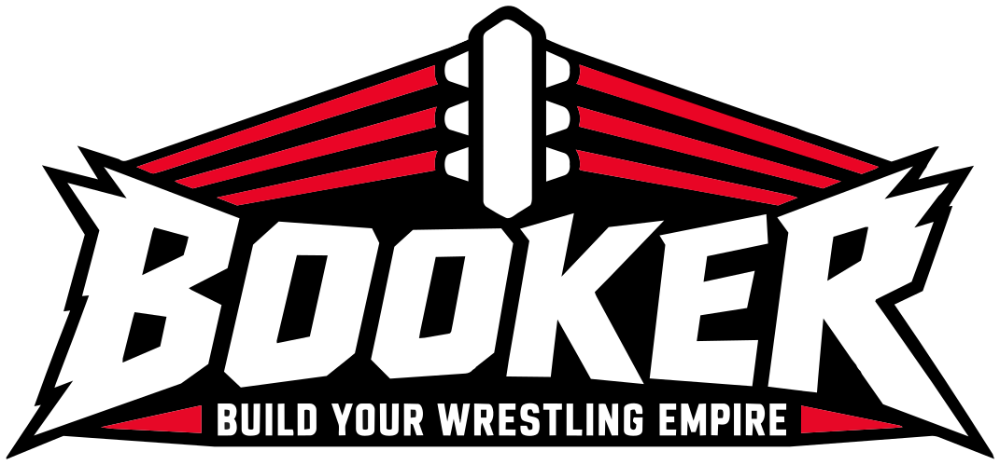

  <picture>
    <source media="(prefers-color-scheme: dark)" srcset="img/booker-logo.svg">
    
  </picture>

# BOOKER Wrestling — site officiel · La Semaine Finale (projet noté CSS avancé)

Site vitrine de la fédération de catch fictive **BOOKER Wrestling**. L'événement vedette est la **Semaine Finale** (2 au 4 avril 2027) : trois nuits (Prelude to Chaos, Rising Empire, Final Chapter), six ceintures défendues chaque soir, 26 combats avec stipulations, sans horaires. Direction artistique : hero en triptyque (un panneau oblique par nuit, aux couleurs de son show), grain, projecteurs et cordes du ring, cartes de lutteurs sur fond noir à logo BOOKER, ceintures du jeu BOOKER. Elle reprend la charte graphique de la fédération (rouge `#E11D2E`, Bebas Neue + Montserrat, angles coupés), **réalisée par Lucas TERNEL, ainsi que tous les logos : logo BOOKER et logos des trois shows (Prelude to Chaos, Rising Empire, Final Chapter)**.

## Groupe

| | |
|---|---|
| Membres | Lucas TERNEL - MMI3 WEB |
| Événement / thème | Fédération de catch fictive — « BOOKER : La Semaine Finale » (thème libre, à faire valider par l'enseignant) |
| Lien du dépôt Git | https://github.com/LucasTernel/booker |
| Convention de nommage | BEM : `.bloc`, `.bloc__element`, `.bloc--variante` ; utilitaires préfixés `u-`. Le nesting natif n'accepte pas `&__element` : on écrit `& .bloc__element` à l'intérieur du bloc. |

## Localisation des exigences

| Barème | Exigence | Élément | Fichier:ligne | Commentaire |
|---|---|---|---|---|
| A1 | 1. Architecture | Ordre des `@layer | `css/main.css:16` | Déclaré une seule fois, avant les `@import`. Chaque fichier enveloppe son contenu dans son layer. |
| A2 | 1. Architecture | Tokens primitifs | `css/tokens.css:12` | Palette BOOKER, palettes des 3 shows, espacements, durées, polices. |
| A2 | 1. Architecture | Tokens sémantiques | `css/tokens.css:63` | `--color-surface`, `--color-text`, `--color-accent`, `--color-action`, `--show-*`… Les composants n'utilisent que ceux-ci. |
| A3 | 1. Architecture | Nesting natif | `css/components.css:832` (`.card`) | `.card { &:hover {…} & .card__media { &::before {…} } }`, 3 niveaux maximum (mesuré). Nommage BEM. |
| B1 | 2. Mise en page | `grid-template-areas` | `css/layout.css:94` (programme), `css/layout.css:132` (ceintures), `css/layout.css:268` (fédération), `css/layout.css:249` (réservation) | Mobile : 1 colonne ; desktop : colonnes nommées. |
| B2 | 2. Mise en page | `subgrid` | `css/components.css:714` (combats), `css/components.css:835` (cartes lutteurs) | Numéros/titres alignés par soirée ; visuel, nom, rôle, bio, jauges et lien alignés d'une carte à l'autre. |
| B3 | 2. Mise en page | Flexbox | `css/layout.css:20` (en-tête), `css/layout.css:78` (triptyque), `css/components.css:26` (nav) | Avec `gap` et `flex-wrap`. |
| C1 | 3. Responsive | Mobile-first | `css/layout.css:40` | `@media (width >= 48rem)` puis `64rem`, jamais de `max-width`. |
| C1 | 3. Responsive | `clamp()` | `css/tokens.css:121` | Titres, corps, espacements fluides, dans les tokens. |
| C2 | 3. Responsive | Container query | `css/layout.css:186` et `css/layout.css:179` (2 contextes) ; `css/components.css:1008` | La carte lutteur : large dans la grille (conteneur ≥ 40rem), compacte dans l'aside du champion. |
| C3 | 3. Responsive | 320 px | `css/base.css:24` ; `css/layout.css:171` | Mesuré à 320 px sur les 9 pages, aussi avec le texte A+++ et à 640 px (zoom 200 %) : aucun élément ne dépasse. |
| D1 | 4. Sélecteurs | `:has()` | `css/components.css:1212` | `.offer:has(.offer__badge)`. Aussi : thème, cartes radio, nuit du Pass soirée, confirmation. |
| D1 | 4. Sélecteurs | `:is()` / `:where()` | `css/base.css:29`, `css/base.css:42` | `:where()` : spécificité nulle. |
| D2 | 5. Thème | `light-dark()` + `color-scheme` | `css/tokens.css:65`, `css/tokens.css:67` | Clair et sombre complets. Hero et footer restent sombres (charte BOOKER) ; l'en-tête suit le thème. |
| Bonus | 5. Thème | Panneau Accessibilité | `css/tokens.css:149` ; `index.html` (`#a11y`) | Auto / Clair / Sombre via `:root:has(#theme-sombre:checked)`, sans JS. Taille du texte : css/base.css:14. Le logo de l'en-tête suit : css/tokens.css:114. |
| E1 | 6. Animations | Transitions | `css/components.css:357` (`.btn`), `css/components.css:832` (`.card`), `css/components.css:511` (`.night`), `css/components.css:1167` (`.offer`) | `translate`, couleurs, `rotate`, `opacity`. Pas de `all`. Durées et courbes = tokens. |
| E2 | 6. Animations | `@keyframes` | `css/components.css:1589` ; usage `css/components.css:482` | `pop-in` (titre et panneaux du hero), `slide-in` (FAQ), `sway` (projecteurs, 4 itérations puis arrêt). Aucune animation infinie. |
| E3 | 6. Animations | `prefers-reduced-motion` | `css/utilities.css:23` | Durées ramenées à ~0 ; l'état final est visible (rien ne reste à `opacity: 0`). |
| Bonus | 6. Animations | Scroll-driven | `css/components.css:1612` | `animation-timeline: view()` dans `@supports` et `no-preference`. |
| Bonus | 6. Animations | Popover + `@starting-style` | `css/components.css:261` | Panneau Accessibilité animé à l'ouverture. |
| Bonus | 6. Animations | View Transitions | `css/main.css:27` | `@view-transition { navigation: auto }` ; repli : navigation classique. |
| F1 | 7. Accessibilité | Landmarks, titres, `alt` | toutes les pages | `lang="fr"`, `header`/`nav`/`main`/`footer`, un seul `h1` par page, FAQ en `details`, 0 image sans `alt`. |
| F2 | 7. Accessibilité | `:focus-visible` | `css/base.css:53`, `css/base.css:59` | Anneau 3 px ; blanc sur les zones toujours sombres ; anneau des boutons découpés dessiné à l'intérieur. |
| F2 | 7. Accessibilité | Contrastes AA | mesurés dans le navigateur | Couleurs calculées, 2 thèmes : 0 échec sur l'accueil et la réservation. Bordures de champs ≥ 3:1. |
| G1 | — | Identité | `css/tokens.css:60` | 2 familles (Bebas Neue, Montserrat) ; charte BOOKER. |
| A4 | 8. Qualité | W3C CSS / HTML | section « Validateur W3C » ci-dessous | CSS : 0 vraie erreur ; HTML (Nu) : 0 erreur sur les 9 pages. |
| A4 | 8. Qualité | `!important` | aucun | Les conflits sont réglés par les layers. |

## Validateur W3C (13/11/2026)

**CSS** (jigsaw.w3.org, CSS niveau 3 + SVG, avertissements activés) : `reset`, `tokens`, `base`, `utilities` sans erreur ni message ; `layout` 4 message(s), `components` 10, `main` 2. Les 16 messages restants sont tous des syntaxes récentes que le validateur ne connaît pas encore, aucune vraie faute. Les autres avertissements sont « CSS variables are not statically checked ».

| Fichier:ligne | Message du validateur | Pourquoi c'est valide |
|---|---|---|
| `css/layout.css:19` | Property « anchor-name » doesn't exist : | Anchor positioning (`anchor-name`, `position-anchor`, `anchor()`), dans un `@supports`, repli sur `--header-height`. |
| `css/layout.css:21` | Property « anchor-name » doesn't exist : | Anchor positioning (`anchor-name`, `position-anchor`, `anchor()`), dans un `@supports`, repli sur `--header-height`. |
| `css/layout.css:182` | Property « container » doesn't exist. The closest matching property name is « co | Raccourci de `container-name` + `container-type` (Baseline 2023). |
| `css/layout.css:187` | Property « container » doesn't exist. The closest matching property name is « co | Raccourci de `container-name` + `container-type` (Baseline 2023). |
| `css/components.css:85` | Unrecognized at-rule « @starting-style » | `@starting-style` (Baseline 2024). |
| `css/components.css:92` | Property « anchor-name » doesn't exist : | Anchor positioning (`anchor-name`, `position-anchor`, `anchor()`), dans un `@supports`, repli sur `--header-height`. |
| `css/components.css:93` | Property « position-anchor » doesn't exist : | Anchor positioning (`anchor-name`, `position-anchor`, `anchor()`), dans un `@supports`, repli sur `--header-height`. |
| `css/components.css:94` | « anchor(bottom) » is not a « inset » value : | Anchor positioning (`anchor-name`, `position-anchor`, `anchor()`), dans un `@supports`, repli sur `--header-height`. |
| `css/components.css:284` | Unrecognized at-rule « @starting-style » | `@starting-style` (Baseline 2024). |
| `css/components.css:1008` | Unrecognized at-rule « @container » | Raccourci de `container-name` + `container-type` (Baseline 2023). |
| `css/components.css:1026` | Unrecognized at-rule « @container » | Raccourci de `container-name` + `container-type` (Baseline 2023). |
| `css/components.css:1611` | Property « animation-timeline » doesn't exist : | `animation-timeline` / `animation-range` : écrits dans un `@supports`, repli sans effet. |
| `css/components.css:1617` | Property « animation-timeline » doesn't exist : | `animation-timeline` / `animation-range` : écrits dans un `@supports`, repli sans effet. |
| `css/components.css:1618` | Property « animation-range » doesn't exist : | `animation-timeline` / `animation-range` : écrits dans un `@supports`, repli sans effet. |
| `css/main.css:18` | @import are not allowed after any valid statement other than @charset and @impor | `@layer a, b;` (sans bloc) est autorisé avant les `@import` par la spécification ; le validateur est en retard. |
| `css/main.css:19` | @import are not allowed after any valid statement other than @charset and @impor | `@layer a, b;` (sans bloc) est autorisé avant les `@import` par la spécification ; le validateur est en retard. |

**HTML** (validator.w3.org/nu) : **0 erreur et 0 avertissement** sur les 9 pages.

## Pages du site

| Page | Rôle |
|---|---|
| `index.html` | Accueil du site de la fédération : hero (Semaine Finale), La fédération (chiffres), programme (26 combats), ceintures, lutteurs, billetterie, actualités, FAQ, newsletter (confirmation en `:target`, sans JS) |
| `reservation.html` | Réservation (facultative) : pass en cartes radio stylées avec `:has()`, nuit affichée seulement pour le Pass soirée, confirmation en `:target` |
| `infos-pratiques.html` | Accès, horaires, règlement intérieur |
| `credits.html` | Crédits : logos, ceintures, photos, polices, réalisation |
| `cgv.html`, `mentions-legales.html`, `confidentialite.html`, `cookies.html`, `accessibilite.html` | Pages légales, liées depuis le footer. Contenu fictif, rédigé comme sur un site réel. |

Les boutons « Choisir » de la billetterie mènent à `reservation.html#pass-…`. Aucune donnée n'est envoyée (événement fictif).

## Domaine

Site en ligne sur `https://booker.lucasternel.com/` : balises `canonical` et Open Graph sur chaque page, `robots.txt` et `sitemap.xml` à la racine, mention dans `mentions-legales.html`. Les liens internes restent relatifs (le site fonctionne aussi ouvert en local).

## Bonus technique revendiqué

| Fonctionnalité | Fichier:ligne | Explication (et repli) |
|---|---|---|
| Animation pilotée par le scroll | `css/components.css:1612` | `animation-timeline: view()` dans `@supports` et `no-preference` ; sans support (Firefox) la page reste affichée normalement. |
| Popover + `@starting-style` | `css/components.css:261` | Panneau Accessibilité ; sans `@starting-style`, il s'affiche sans animation. |
| Bascule de thème CSS-only | `css/tokens.css:149` | Radios + `:has()` qui changent `color-scheme` sur `:root`. |
| Menu burger mobile (Popover API + `@starting-style`) | `css/components.css:48`, `css/components.css:141` | Panneau qui glisse à l'ouverture ; le bouton se transforme en croix via `:has(:popover-open)`. Desktop : la liste redevient une barre en ligne. |
| Anchor positioning | `css/layout.css:19` | Le menu se cale sous l'en-tête quelle que soit sa hauteur, dans un `@supports` ; repli : `--header-height`. |
| View Transitions entre pages | `css/main.css:27` | Ignorées sans support : navigation classique. |

## JavaScript (15 lignes de code, un seul fichier)

| Fichier:lignes | Ce que fait le code | Pourquoi ce n'était pas faisable en CSS |
|---|---|---|
| `js/main.js:3-13` | Mémorise dans `localStorage` le thème et la taille du texte choisis dans le panneau Accessibilité et les restaure. | Le CSS seul ne conserve aucun état après un rechargement. |
| `js/main.js:16-17` | Sur `reservation.html#pass-…`, coche le pass visé par le bouton « Choisir ». | `:target` peut styler un élément, pas cocher une case. Sans JS, le Pass 3 nuits reste coché par défaut. |
| `js/main.js:19-21` | Un clic sur un lien du menu burger (mobile) referme le popover. | Un lien ne peut pas porter `popovertargetaction` ; sans JS, le menu reste ouvert jusqu'à un clic ailleurs ou la touche Échap. |

## Déclaration d'usage d'outils d'IA

| Outil | Pour quoi faire | Parties concernées |
|---|---|---|
| Claude Code | Génération du code du site à partir du cahier des charges, de la charte BOOKER et des TP ; détourage des photos ; mesures (contrastes, focus, débordements) ; rédaction du README | Tout le dépôt |

> Chaque membre doit pouvoir expliquer chaque ligne en soutenance (question individuelle, critère H).

## Qui a fait quoi

| Membre | Principales contributions |
|---|---|
| Lucas TERNEL | Conception et intégration du site (HTML, CSS, JavaScript), contenu, visuels, validation W3C, mise en ligne du dépôt |

## Crédits

Détail sur la page `credits.html` (liée depuis le footer de chaque page).

- **Charte graphique, logo BOOKER et logos des trois shows (Prelude to Chaos, Rising Empire, Final Chapter) : réalisés par Lucas TERNEL** (projet BOOKER). Favicons : coin du ring du logo BOOKER, dans `assets/favicons/`.
- Ceintures Booker Universal Championship et IUT Lens Championship : visuels du jeu BOOKER.
- Photos de 6 catcheurs : Wikimedia Commons, CC BY 2.0 (auteurs et liens dans `credits.html`), détourées et recadrées.
- Portraits de Lucas Ternel et de l'équipe pédagogique : photos fournies par l'éditeur, dans `img/lutteurs/`.
- Polices : Bebas Neue et Montserrat (SIL OFL), via Google Fonts.
